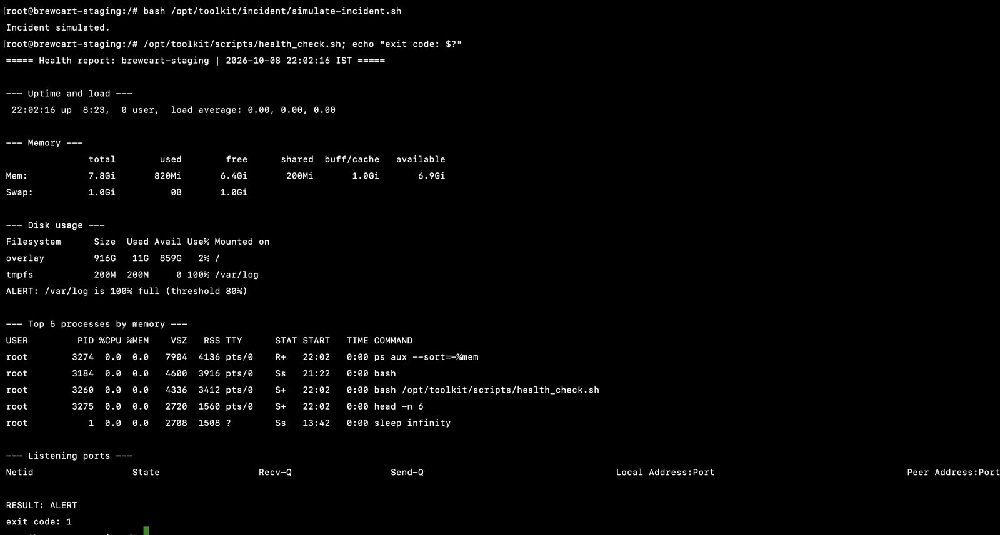
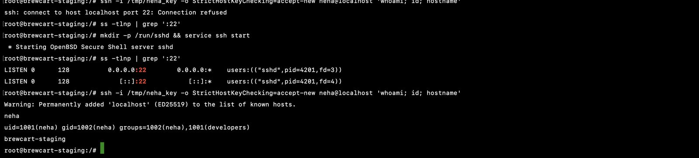

# Project 01: Linux Ops Toolkit

**Real-World DevOps Projects** · Part 1 of 20 · Rohan Aviral

> **Ticket OPS-101.** The staging server's disk filled up overnight and nobody noticed for six hours. Find out what happened, fix it, and make sure it can't happen quietly again.

This repo contains the Bash toolkit built in response: a health check that alerts, a log clean-up with a dry-run mode, a user onboarding script for SSH-key access, the cron schedule that runs them, and a runbook for the next time a disk fills up.

📄 Full step-by-step write-up with screenshots: [docs/Project_01_Linux_Ops_Toolkit.pdf](docs/Project_01_Linux_Ops_Toolkit.pdf)
⬅️ Previous: [Project 00, Workstation Set-up](https://github.com/Aviral-Rohan/devops-project-00-workstation-setup) · ➡️ Next: Project 02, Git Team Workflow

---

## What's inside

```
devops-project-01-linux-ops-toolkit/
├── scripts/
│   ├── health_check.sh       # uptime, memory, disk, processes, ports; exits 1 above a disk threshold
│   ├── log_cleanup.sh        # gzip logs > 7 days, delete logs > 30 days, --dry-run supported
│   └── onboard_user.sh       # create user + group, install SSH public key with correct permissions
├── cron/toolkit.crontab      # health check every 5 min, clean-up daily at 02:00
├── runbooks/disk-full.md     # what to do when a disk fills up
├── incident/simulate-incident.sh   # reproduces the original incident (staging only)
└── docs/                     # write-up PDF and screenshots
```

## Quick start

Run a disposable Ubuntu "server" with a small 200 MB `/var/log`, and this repo mounted inside it:

```bash
docker run -d --name brewcart-staging --hostname brewcart-staging \
  --tmpfs /var/log:rw,size=200m -v "$PWD":/opt/toolkit ubuntu:24.04 sleep infinity
docker exec -it brewcart-staging bash
apt update && apt install -y cron procps iproute2 openssh-server openssh-client
```

Then, inside the container:

```bash
bash /opt/toolkit/incident/simulate-incident.sh          # fill the disk
/opt/toolkit/scripts/health_check.sh; echo $?           # ALERT, exit 1
truncate -s 0 /var/log/brewcart/debug.log               # fix
/opt/toolkit/scripts/log_cleanup.sh --dry-run           # preview the clean-up
/opt/toolkit/scripts/log_cleanup.sh                     # run it
/opt/toolkit/scripts/onboard_user.sh neha /path/to/neha.pub
crontab /opt/toolkit/cron/toolkit.crontab && service cron start
```

## The scripts

### `health_check.sh [threshold]`

| Section | Command used |
|---|---|
| Uptime and load | `uptime` |
| Memory | `free -h` |
| Disk, with alert above the threshold (default 80%) | `df --output=pcent` |
| Top 5 processes by memory | `ps aux --sort=-%mem` |
| Listening ports | `ss -tulpn` |

Exit code `0` = healthy, `1` = alert, so cron, CI or a monitoring agent can act on it.



### `log_cleanup.sh [--dry-run] [dir]`

| Log age | Action |
|---|---|
| 0 to 7 days | Kept |
| 8 to 30 days | Compressed with gzip |
| Over 30 days | Deleted |

Every destructive command goes through one `run()` function, so `--dry-run` prints instead of executing. It's idempotent: a second run does nothing. In testing it shrank the log folder from **27 MB to 9.1 MB**.

### `onboard_user.sh <user> <pubkey> [group]`

Creates the user and group if missing, installs the key in `~/.ssh/authorized_keys` without duplicates, and enforces `700` on `.ssh` and `600` on the key file. Safe to run repeatedly.



## Problems I hit

| Problem | Cause | Fix |
|---|---|---|
| `/var/log` 100% full | `debug.log` (173 MB): debug logging left on in a release | `truncate -s 0`, then scheduled clean-up and alerting |
| `bad interpreter: Permission denied`, exit 126 | Script not executable | `chmod +x` |
| Dry run listed 6 files to compress, real run compressed 3 | Dry run counted files that the delete step would remove | Compress step skips anything older than the delete age (`! -mtime +30`) |
| `ssh: connect to host localhost port 22: Connection refused` | sshd installed but not running (containers don't auto-start services) | `ss -tlnp` showed nothing on :22; started sshd |
| Cron lines saved as a file name in nano | Pasted at the Ctrl+O prompt instead of into the editor | Added jobs non-interactively: `(crontab -l; echo '...') \| crontab -` |

## What I learned

- Reproduce an incident before automating the fix.
- `df` finds the full disk, `du | sort -h` finds the culprit, `truncate` frees space safely.
- Exit codes are how scripts talk to other tools: 0, 1, 126, 127 each mean something.
- Anything that deletes files needs a dry-run mode that matches the real run exactly.
- "Connection refused" means nothing is listening; check with `ss -tlnp` before anything else.

## License

MIT
